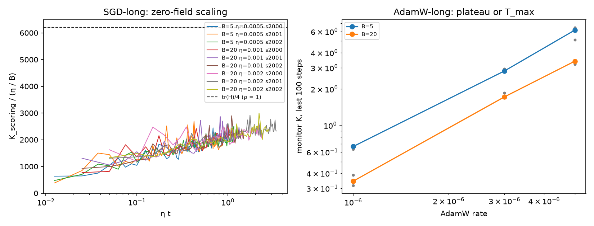

# Study 2 Stage A: K-only analyses

Analyses of Stage A's discovery records that use only K, curvature and the numerical screen, never
harm. They do not enter the [selection rule](study2-preregistration.md#selection-rule). The harm
embargo of the [preregistration](study2-preregistration.md#outcome-embargo) applies unchanged.

## Recorded predictions

### SGD-long at 0.001, B = 20

Recorded on 2026-10-15, after the first search step's SGD-long runs at 0.002 (B = 20) and 0.0005
(B = 5) and before any run at 0.001 exists.

**The law.** In the zero field every training response is a fresh sample from θ₀. Near θ₀ the
expected loss is then quadratic, ½ δᵀHδ. The loss divides a batch's summed NLL by B × 96, and
the sequence-level Fisher information F_seq of θ₀'s own samples equals their expected Hessian.
So H = F_seq / 96, and the gradient noise of a batch of B examples has covariance
F_seq / (96² B) = H / (96 B). SGD without momentum, δ ← δ − η(Hδ + ξ), then gives in each
eigendirection i of H

    Var_i(t) = (η / (192 B)) · (1 − (1 − ηλ_i)^(2t)) / (1 − ηλ_i / 2).

K_benign averages the summed per-token KL over the panel's sequences, so K ≈ ½ δᵀF_Kδ with F_K
the panel's sequence-level Fisher information. If F_K ≈ ρ F_seq = 96 ρ H in the directions that
move, then for ηλ_i ≪ 1

    K(t; η, B) ≈ (η / B) · g(η t),    g(x) = (ρ / 4) Σ_i λ_i (1 − exp(−2 λ_i x)),

with ρ ≈ 1 when the panel's sequences carry the training sequences' Fisher information. g
depends only on the spectrum, not on η or B. Two runs therefore map onto each other without a
free parameter: K at (η, B, t) equals (η B′ / η′ B) times K at (η′, B′, t η / η′).

**Already checked.** On seed 2002, SGD-long at 0.0005 and B = 5 against 0.002 and B = 20 at
equal ηt (the B = 5 run's step 4t against the B = 20 run's step t). The median ratio of their
monitor K is 0.85 over the B = 5 run's steps 100–300, 0.95 over 300–600, 0.97 over 600–1000 and
0.97 over 1000–1600.

**Prediction.** For 0.001 at B = 20, K_0.001(t) = ½ K_0.002(t / 2) on the same seed. Seed 2002's
0.002 run, which stopped by plateau at step 1400 with a median monitor K of 0.254 over its last
100 steps, predicts the following. The values are medians of the rescaled monitor readings
within 50 steps of t, and the plateau rule (from step 1000, six windows of 100 steps) is applied
to those readings.

| Step t | Predicted K |
|---|---|
| 1000 | 0.104 |
| 1400 | 0.116 |
| 2000 | 0.128 |
| 2800 | 0.129 |

- The run stops by plateau between steps 1000 and 2800; on the rescaled readings the rule fires at
  step 1200. It reaches no level.
- At the stop, its median monitor K over the last 100 steps lies between 0.10 and 0.13.
- The same holds on seeds 2000 and 2001, each scaled from its own run at 0.002.

**What would contradict it.** On any seed, a median monitor K over the last 100 steps outside
0.08–0.16 at the stop. Also, a median ratio K_0.001(t) / (½ K_0.002(t / 2)) outside 0.85–1.15
over steps 1000 to the stop on the same seed.

## The barrier of SGD-long

The search's nine version-2 SGD-long runs: three seeds each at 0.0005 (B = 5), 0.002 (B = 20) and
0.001 (B = 20). Every one stopped by plateau, with a median monitor K over its last 100 steps of
0.11–0.26 against a lower level of 5. The numbers come from `scripts/stage_a_barrier.py` at commit
`7624d7e` (`runs/analysis/stage-a-barrier-2026-10-15/barrier.json`, archived with the runs). It
reads K, curvature and the screen's stops only.

- **The law holds.**
  - K / (η/B) against ηt falls on one curve g for all nine runs. Each run's median ratio to the
    common g is 0.97–1.02. This is a consistency check, since the runs also define g.
  - The held-out test is the prediction recorded before the runs at 0.001 existed. At the stop,
    the median K over the last 100 steps was 0.110, 0.112 and 0.122 on seeds 2000–2002, against
    the predicted 0.10–0.13. The median ratio to ½ K_0.002(t / 2) on the same seed was 1.042,
    0.965 and 1.031, against the band 0.85–1.15.
- **g.**
  - It rises slowly, roughly with log ηt: from ≈ 500–800 at ηt = 0.01–0.03 to ≈ 2400 at
    ηt ≈ 3.
  - Its bound for full equilibrium is tr(H)/4 ≈ 6200 (ρ = 1). tr(H) ≈ 2.5·10⁴ (1.7–3.0·10⁴) is
    the Hutchinson estimate from the first Lanczos coefficient of all 14 starts of the curvature
    run, over 1.31·10⁹ trainable parameters.
  - The 60-step Lanczos runs resolve only the top of the spectrum: 691 pooled, 697–1067 for
    single batches. The bulk that sets g at small ηt is not resolved, so the spectrum bounds g
    but does not predict it.
- **Stability caps η/B.**
  - The screen passed 0.0005 at B = 5 (0.001 failed) and 0.002 at B = 20 (0.003 failed). That is
    η/B ≈ 1–2·10⁻⁴ at both batches.
  - Within T_max = 4000 steps this keeps K ≤ (η/B)·g(η·4000), a few tenths.
  - A caveat on those edges: the screen's stops, like the full controls' stops, came from the
    gradient rule on single batches of the soft-target noise floor, without growth. At B = 5,
    0.002–0.004 all stopped at step 12; at B = 20, 0.003 and 0.004 both stopped at step 17. Only
    0.006 at B = 20 grew geometrically, ×1.4 per step. The true edges are likely higher, so these
    caps are lower bounds.
  - Even η/B = 3·10⁻⁴ would give K ≈ 0.75 at ηt ≈ 3, still far below 5.
- **AdamW-long, for contrast** (version-1 monitor, runs stopped by plateau or T_max).
  - The final K grows faster than linearly with the rate: ×9.2–9.9 for ×5 in η, about η^1.4.
  - It falls with the batch about as B^−0.45: the ratio of B = 5 to B = 20 is 1.6–1.9.
  - Adam's normalization drives the flat, low-noise directions, which plain SGD barely moves.
- **What it means.**
  - At the rates the numerics allow, plain SGD-long settles at K of a few tenths and approaches
    its bound only logarithmically.
  - The barrier follows from the zero-field law and the stability cap, not from the monitor or
    the plateau rule.
